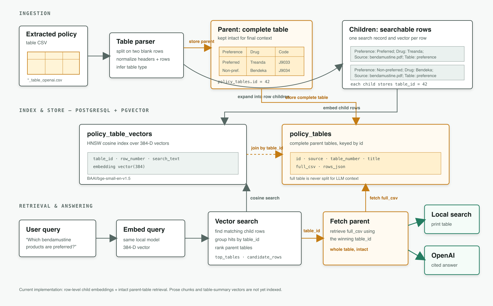

# GEHA

Experiments in retrieval, document ingestion and agent design over GEHA's public
plan documents: 2026 dental benefits, the FEDVIP dental brochure, and medical
coverage policies. Not affiliated with G.E.H.A. Everything here uses public
documents or synthetic data; nothing is production- or HIPAA-ready.

Most projects are **workflows**, not free-running agents: code owns the control
flow, and the LLM extracts, grades, rewrites or corrects inside bounded loops.
Each subfolder has its own README with setup and results.

## Repository map

| Folder | What it is | Pattern |
|---|---|---|
| [`crawl_dir`](crawl_dir/README.md) | Canonical document corpus (54 public PDFs) and the `geha-ingestion` MCP server | Ingestion workflow behind MCP tools |
| [`document_ingestion_workflow`](document_ingestion_workflow/README.md) | React UI that streams one ingestion run: source page, vision HTML, visual correction, verified HTML | Deterministic workflow |
| [`PDF_processing`](PDF_processing/) | Page blocking and bill-of-lading OCR benchmarks | Evaluator-optimizer loops |
| [`chunking_benchmarks_RAG`](chunking_benchmarks_RAG/README.md) | Table-aware coverage-policy RAG, billing-code lookup, 11 eval families | Routing + parent-document retrieval |
| [`agentic_search`](agentic_search/README.md) | Chroma RAG with a CRAG/Self-RAG LangGraph loop and a ReAct variant | Evaluator-optimizer, ReAct |
| [`agentic_search_corpus`](agentic_search_corpus/README.md) | The agentic search code over canonical dental page Markdown | BM25 / vector / hybrid + agentic answers |
| [`e2e_bm25vector`](e2e_bm25vector/README.md) | Deployable Vercel app comparing BM25, vector and hybrid retrieval | Retrieval comparison |
| [`dspy_dental_chatbot`](dspy_dental_chatbot/README.md) | FEDVIP enrollment state machine, DSPy/JEV normalizers, and cited dental policy Q&A | Deterministic workflow + DSPy programs |
| [`mcp_benefits_server`](mcp_benefits_server/README.md) | MCP server for dental and coverage-policy tools with a promotion standard | Deterministic tools, tiered by deployment |
| [`aws_rag`](aws_rag/README.md) | Serverless AWS RAG over 203 ML papers | Hybrid BM25/pgvector + RRF + rerank |
| [`hapi`](hapi/README.md) | Local HAPI FHIR server with Synthea patients; claim insights, fraud and agent demos | FHIR tools, tool-calling agents |
| `finetuning` | Slides: fine-tuning EmbeddingGemma for insurance retrieval | — |
| `docs` | Shared diagrams (RAG variants, agent loop vs harness, context window) and slide decks | — |

## Documents and ingestion

### `crawl_dir`: the source of truth

All projects read documents from `crawl_dir` through
`crawl_dir.src.consumer_paths`. Its layers are `raw` (original PDFs), `runs`
(immutable candidate extractions) and `reviewed` (promoted artifacts).
Production code must use `reviewed`. Demos may request the newest structurally
valid candidate while visual review is pending.

Two of the 31 original policy PDFs had no text layer. Running LLM OCR on those
image-only pages improved retrieval by about 6%.

The `geha-ingestion` MCP server (`python -m crawl_dir.src.ingestion_mcp`) lets an
agent list and download manifest-pinned public PDFs and ingest them. Every tool
previews first and needs `confirm=true` before it writes files or calls Claude.

### Page-level visual correction

Sending a 200-page PDF to an LLM for OCR produces errors. The pipeline splits
it into single pages, converts each to Markdown and HTML, renders the HTML, and
has a LangGraph loop compare it with the page image and correct it, bounded to
2–7 passes. This reaches zero visible errors but is slow for large batches.
`document_ingestion_workflow` visualizes these runs, including the EY/LIMRA
report, where pages with figures go through whole-page semantic HTML instead
of bounding-box segmentation.

### `PDF_processing`

- `blocking_demo`: segmenting a page into blocks before vision OCR. Whole-page
  submission fails on dense forms; blocks plus a 4+-pass correction loop work.
  Claude reproduces chart detail that GPT does not.
- `bill_lading`: no public medical claim forms exist, so a bill of lading
  stands in. GPT-4o, GPT-5, Claude and PaddleOCR-VL 1.6 all reach 79/79 fields
  on the 8-block benchmark; PaddleOCR-VL is about 6× faster than GPT-4o.

## Retrieval

### Table-aware RAG (`chunking_benchmarks_RAG`)

Embedding table rows with their headers loses the table's meaning. This
system embeds rows for retrieval but returns the whole table as parent context,
and sends the agent only a few rows (a 200-row table is 5,000–10,000 tokens;
3 rows are about 200). Exact keyword queries such as billing codes do better
with BM25 or structured lookup than with vector search.



```bash
cd /Users/dc/geha
uv sync
docker compose -f chunking_benchmarks_RAG/docker-compose.pgvector.yml up -d
uv run python chunking_benchmarks_RAG/table_rag.py init-db
```

The same program provides `ingest`, `search` and `ask`; see its README.

### Agentic search (`agentic_search`, `agentic_search_corpus`)

A LangGraph loop based on CRAG and Self-RAG: retrieve and rerank, grade each
passage, rewrite the query at most twice or abstain, generate from the original
question, then check every claim is supported (at most two generations). The
corpus variant runs the same loop over the canonical dental page Markdown with
BM25, vector or hybrid retrieval. The chat UI and PDF viewer come from the
[Lightning AI document chat template](https://lightning.ai/lightning-ai/templates/document-chat-assistant-using-rag?section=featured).

### Cloud RAG

- `aws_rag`: hybrid BM25 + pgvector, RRF and Bedrock reranking reach hit@5 0.95
  and MRR@10 0.88. Chat endpoint:
  https://pdh62b4ddxm6mw7aokdbtwream0nupph.lambda-url.us-west-2.on.aws/chat
- `e2e_bm25vector`: Vercel + Neon app for side-by-side retrieval experiments.

## Chatbots and tools

- **Enrollment** (`dspy_dental_chatbot`): matching a member to a plan is a
  process, not a similarity search, so enrollment is a state machine. Plan
  recommendations and premiums come deterministically from benefits-guide pages
  4–11. JEV or DSPy may classify free-text answers but never decide eligibility,
  rate codes, plans or premiums. The same app keeps this workflow in a separate
  tab from page-aware benefit Q&A, cited DSPy answers, and persona tests.
- **MCP benefits server** (`mcp_benefits_server`): rate codes, premiums, CDT
  classes and coverage-policy search as tools. Each deployment (production,
  pilot, sandbox) lists only the tools promoted to its tier; PHI arguments are
  hashed in the audit log, and CI fails when a tool claims a tier it does not meet.
- **FHIR sandbox** (`hapi`): synthetic patients for testing FHIR MCP tools,
  claim-insight queries and fraud-detection agents.

## Continuous integration

[GEHA CI](.github/workflows/ci.yml) runs on pull requests and pushes to `main`:
`chunking_benchmarks_RAG` and `agentic_search` unit tests, the `crawl_dir` MCP
server tests, the standalone table RAG and `aws_rag` unit
tests, and retrieval benchmarks for `aws_rag` (62 questions) and
`agentic_search`. Tests use local fixtures and need no API key, live database or
model download. Database-backed evaluations, vision review and deployment
tests stay manual. CI does not certify clinical correctness or HIPAA compliance.
