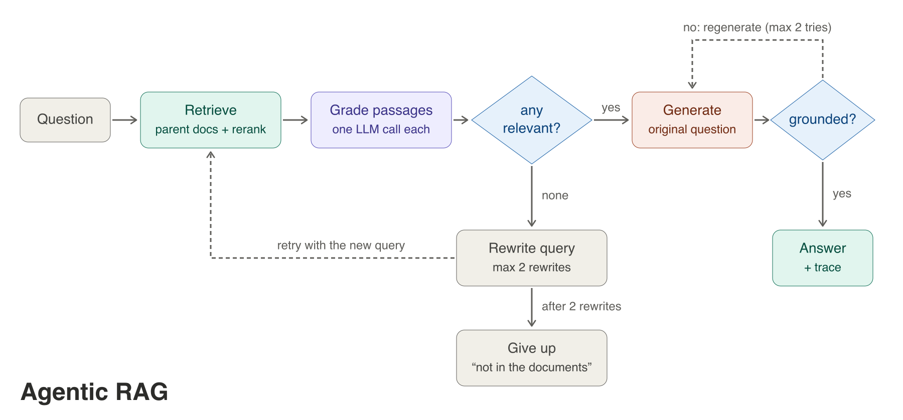

# Agentic RAG search

This project implements two bounded search workflows over scientific papers:

- a fixed corrective-RAG loop in `src/agentic_rag.py`; and
- a model-directed ReAct loop in `src/react_rag.py`.

The corrective loop can search either locally indexed PDFs or the deployed
`aws_rag` paper corpus. AWS mode uses the existing hybrid retrieval and reranking
service and does not open the local Chroma index.

## Corrective-RAG workflow

[](docs/agentic_rag.png)

The fixed LangGraph workflow is inspired by
[CRAG](https://arxiv.org/abs/2401.15884) and
[Self-RAG](https://arxiv.org/abs/2310.11511):

1. Retrieve and rerank passages for the current query.
2. Assess their relevance and whether the accumulated evidence covers every
   part of the original question.
3. If evidence is incomplete and the rewrite budget remains, issue one focused
   follow-up query. The default budget is one follow-up retrieval.
4. Generate an answer from the accumulated evidence and the original question.
5. Check grounding. If the check fails, regenerate once with an explicit
   instruction to remove unsupported claims.

Local-PDF mode grades passages independently. AWS mode instead asks Nova for one
batched relevance-and-completeness decision per retrieval round. Empty or
near-duplicate AWS follow-up queries are replaced with a deterministic query
based on the least-covered named system and the first missing requirement.

`AgenticRag.generate()` returns `response`, `contexts`, `retrieved_contexts`,
`citations`, `grounded`, `complete`, `missing`, `trace`, `searches`,
`retrieval_rounds`, and `generation_attempts`.

## Concrete examples from the 2026-10-22 run

These are recorded behaviors from one 22-question run, not general performance
guarantees. Follow-up text is reproduced from the saved run.

| Outcome | Initial question | Follow-up search | Result |
|---|---|---|---|
| Helped | How large is Orca, and how many ChatGPT and GPT-4 responses were collected to train it? | How many GPT-4 responses were collected to train Orca? | Fact recall improved from **67% to 100%**. |
| Helped | Compare DeepSeek-V3 and Kimi K3: total parameters and activated parameters per token for each. | DeepSeek-V3: total parameters for DeepSeek-V3 | Fact recall improved from **50% to 100%**, although the grounding check failed. |
| Helped | How is web or search-engine access used differently in CRAG and Search-R1? | Search-R1: specific differences in web or search-engine access usage between CRAG and Search-R1 | Fact recall improved from **50% to 100%**, and the grounding check passed. |
| Unnecessary | How many layers are in the Transformer's encoder stack, and how many attention heads does it use? | How many attention heads does the original Transformer architecture use? | Fact recall remained **100%**; latency increased from 3,332 ms to 5,722 ms. |
| Unnecessary | What actions can CRAG's retrieval evaluator trigger, and how is the action chosen? | What specific actions can CRAG's retrieval evaluator trigger? | Fact recall remained **100%**; the narrower search added no measured fact coverage. |
| Harmful | What BLEU scores did the big Transformer achieve on WMT 2014 English-to-German and English-to-French? | English-to-German: BLEU scores for WMT 2014 English-to-French | The follow-up confused the language pairs, and fact recall dropped from **100% to 50%**. |
| Failed | How many attention heads does the original Transformer use compared with DeepSeek-V3's MLA? | How many attention heads does DeepSeek-V3's MLA use? | Fact recall remained **50%**, and the grounding check failed. |
| Should abstain | How many dollars did it cost to train Orca? | What is the specific dollar cost to train Orca according to the paper? | The corpus did not establish an answer. Fact recall remained **0%**, and the grounding check failed. |
| Should abstain | What BLEU score did the Transformer achieve on WMT 2019 English-to-Chinese? | English-to-Chinese: BLEU score for WMT 2019 English-to-Chinese | The requested result was absent from the source paper. Fact recall remained **0%**. |
| No follow-up needed | What reflection tokens does Self-RAG use? | None | The first retrieval achieved **100% fact recall** and passed the grounding check. |

## Setup

The repository-wide environment is recommended because the application imports
the centralized `geha_processing` package:

```bash
cd /Users/dc/geha
UV_CACHE_DIR=/tmp/geha-uv-cache uv sync --locked
```

The application-specific dependency file remains available when the central
package is already importable:

```bash
cd /Users/dc/geha/agentic_search
uv pip install -r requirements.txt
```

Set `OPENAI_API_KEY` before using the local PDF or ReAct workflows. AWS mode
uses AWS credentials and Bedrock Nova instead of OpenAI.

## Test

Run tests from the repository root so `geha_processing` resolves correctly:

```bash
cd /Users/dc/geha
UV_CACHE_DIR=/tmp/geha-uv-cache uv run --no-sync \
  python -m unittest discover -s agentic_search/src -p 'test_*.py' -v
```

This command currently runs 39 offline tests without model, database, or AWS
calls.

## Run against the AWS paper corpus

The deployed `/api/retrieve` endpoint combines BM25 and pgvector retrieval,
reciprocal-rank fusion, and Bedrock reranking. Retrieved chunks retain paper,
page, chunk, table, and figure provenance.

AWS mode does not use the local Chroma index or require `DATABASE_URL`. The
launcher obtains the endpoint and API key from AWS:

```bash
aws login --profile geha-user --region us-west-2   # once per session or expiry
cd /Users/dc/geha/agentic_search
./run_aws_agentic.sh \
  "Compare RAG, ReAct, and Self-RAG. When does each retrieve?"
```

The command reports retrieval rounds, generation attempts, evidence
completeness, and grounding status.

## Run the AWS single-search/corrective comparison

The A/B runner evaluates each question with `max_rewrites=0` and then with
`max_rewrites=1`. It invokes the live retrieval endpoint and Bedrock.

Start with three questions:

```bash
cd /Users/dc/geha/agentic_search
./run_aws_agentic_ab.sh --limit 3
```

Run the complete fixture:

```bash
./run_aws_agentic_ab.sh
```

The runner writes detailed records to `evals/aws_agentic_ab_results.json` and a
summary to `evals/aws_agentic_ab_results.md`. Fact recall is judged with one
batched Nova rubric call per answer. Use `--skip-fact-judge` for a cheaper run
that records only operational metrics.

## Recorded 22-question result (2026-10-22)

The first complete AWS run produced the following macro results. Fact and source
recall are macro averages over the 19 questions marked answerable in that
fixture. Completeness, grounding, follow-up, retrieval-round, generation, and
latency statistics cover all 22 questions. Correct abstention covers the three
questions that the fixture marked unanswerable.

This is one sequential run over a small, non-randomized set. Nova supplies the
fact, evidence-completeness, and grounding judgments, so these results are not a
statistical guarantee or proof that corrective retrieval is generally better.

| Metric | Single search | Corrective | Change |
| --- | ---: | ---: | ---: |
| Fact recall | 56.1% | 63.2% | +7.0 pp |
| Source recall | 57.9% | 57.9% | +0.0 pp |
| Evidence-complete rate | 4.5% | 22.7% | +18.2 pp |
| Grounded-answer rate | 63.6% | 54.5% | -9.1 pp |
| Correct-abstention rate | 0.0% | 0.0% | +0.0 pp |
| Follow-up-search rate | 0.0% | 95.5% | +95.5 pp |
| Mean retrieval rounds | 1.00 | 1.95 | +0.95 |
| Mean generation attempts | 1.41 | 1.50 | +0.09 |
| Median latency | 4,458 ms | 6,887 ms | +2,429 ms |
| p95 latency | 6,851 ms | 9,578 ms | +2,727 ms |

Corrective retrieval improved fact recall on 4 questions, regressed on 1, and
tied on 17. It increased Nova's evidence-complete rate but did not improve
source recall, reduced the grounded-answer rate, and added latency. The 95.5%
follow-up rate means 21 of 22 corrective runs issued a second search; the
single-search baseline was configured not to issue one.

The result demonstrates a quality/latency tradeoff, not an unconditional
improvement. Inspect `evals/aws_agentic_ab_results.json` for answers, selected
citations, searches, traces, and per-question scores.

### Known fixture issue

The recorded run classified the HNSW `M` question as unanswerable. That label is
wrong: `1603.09320v4.pdf` states that typical close-to-optimal `M` values are
between 6 and 48. Therefore, do not use the recorded correct-abstention result as
evidence of abstention quality. Correct `evals/answer_questions.jsonl` and rerun
the evaluation before publishing updated benchmark claims.

## Evaluation questions and rubric answers

These are the rubric facts used by the recorded run. They are evaluation
targets, not answers generated by the system. Question 20 is corrected below,
but the checked-in JSONL and recorded metrics still reflect its old,
incorrectly-unanswerable label.

1. **Transformer layers and heads** (`single`) — How many layers are in the
   Transformer's encoder stack, and how many attention heads does it use?
   - The encoder has 6 identical layers (`N = 6`).
   - It uses 8 attention heads (`h = 8`).
   - Gold source: `1706.03762v7.pdf`.

2. **Transformer BLEU scores** (`single`) — What BLEU scores did the big
   Transformer achieve on WMT 2014 English-to-German and English-to-French?
   - 28.4 BLEU on WMT 2014 English-to-German.
   - 41.8 BLEU on WMT 2014 English-to-French.
   - Gold source: `1706.03762v7.pdf`.

3. **Orca size and training data** (`single`) — How large is Orca, and how many
   ChatGPT and GPT-4 responses were collected to train it?
   - Orca has 13 billion parameters.
   - About 5 million ChatGPT responses were collected.
   - About 1 million GPT-4 responses were collected, sampled from the ChatGPT set.
   - Gold source: `2306.02707.pdf`.

4. **Self-RAG reflection tokens** (`single`) — What reflection tokens does
   Self-RAG use?
   - A Retrieve token decides whether to retrieve.
   - ISREL judges whether a passage is relevant.
   - ISSUP judges whether the output is supported by the passage.
   - ISUSE judges how useful the output is.
   - Gold source: `2310.11511v1.pdf`.

5. **CRAG actions** (`single`) — What actions can CRAG's retrieval evaluator
   trigger, and how is the action chosen?
   - The actions are Correct, Incorrect, and Ambiguous.
   - The action is chosen by comparing the evaluator confidence score with an
     upper and a lower threshold.
   - Incorrect and Ambiguous involve web search.
   - Gold source: `2401.15884v3.pdf`.

6. **DeepSeek-V3 training** (`single`) — How many tokens was DeepSeek-V3
   pre-trained on, and how many GPU hours did its full training take?
   - 14.8 trillion tokens.
   - 2.788 million H800 GPU hours.
   - Gold source: `2412.19437v2.pdf`.

7. **Kimi K3 experts** (`single`) — How many routed experts does Kimi K3's
   Stable LatentMoE have, and how many are active per token?
   - 896 routed experts.
   - 16 experts are activated per token.
   - Gold source: `2607.24653v2.pdf`.

8. **HySparse2 KV sharing** (`single`) — What are the two levels of KV sharing
   in HySparse2?
   - The outer level is KV Bridging: a YOCO-style self-decoder and cross-decoder
     structure that bridges only full-attention layers.
   - The inner level is KV Reuse, retained from HySparse.
   - Prefill can exit after the self-decoder, skipping the cross-decoder layers.
   - Gold source: `2609.26368v1.pdf`.

9. **MoE parameter comparison** (`multi`) — Compare DeepSeek-V3 and Kimi K3:
   total parameters and activated parameters per token for each.
   - DeepSeek-V3 has 671B total parameters and activates 37B per token.
   - Kimi K3 has 2.8 trillion total parameters and activates 104B per token.
   - Gold sources: `2412.19437v2.pdf`, `2607.24653v2.pdf`.

10. **MoE expert comparison** (`multi`) — How many routed experts are activated
    per token in DeepSeek-V3 versus Kimi K3, out of how many?
    - DeepSeek-V3 activates 8 of 256 routed experts per token.
    - Kimi K3 activates 16 of 896 routed experts per token.
    - Gold sources: `2412.19437v2.pdf`, `2607.24653v2.pdf`.

11. **Attention-head comparison** (`multi`) — How many attention heads does the
    original Transformer use compared with DeepSeek-V3's MLA?
    - The Transformer uses 8 attention heads.
    - DeepSeek-V3's MLA uses 128 attention heads.
    - Gold sources: `1706.03762v7.pdf`, `2412.19437v2.pdf`.

12. **RAG evaluator initialization** (`multi`) — What model is CRAG's retrieval
    evaluator initialized from, and what base LM does Self-RAG's final model use?
    - CRAG's retrieval evaluator is initialized from T5-large and fine-tuned.
    - Self-RAG's final model uses Llama2-7B as its base LM.
    - Gold sources: `2401.15884v3.pdf`, `2310.11511v1.pdf`.

13. **RAG correction comparison** (`multi`) — When retrieved documents are poor,
    what does CRAG do, and how does Self-RAG judge passage relevance instead?
    - CRAG falls back to large-scale web search when retrieval is judged
      Incorrect or Ambiguous.
    - Self-RAG predicts an ISREL reflection token to judge passage relevance.
    - Gold sources: `2401.15884v3.pdf`, `2310.11511v1.pdf`.

14. **Three-way retrieval control** (`multi`) — Compare how CRAG, Self-RAG, and
    Search-R1 decide when or how to retrieve more information.
    - CRAG uses a lightweight evaluator to assess retrieved-document quality and
      trigger corrective retrieval actions.
    - Self-RAG uses a reflection token to decide whether to retrieve on demand.
    - Search-R1 learns to generate multiple search queries during step-by-step
      reasoning through reinforcement learning.
    - Gold sources: `2401.15884v3.pdf`, `2310.11511v1.pdf`, `2503.09516v5.pdf`.

15. **Web/search timing** (`multi`) — How is web or search-engine access used
    differently in CRAG and Search-R1?
    - CRAG uses large-scale web search when its evaluator judges retrieved
      documents to be poor or uncertain.
    - Search-R1 performs multi-turn search interactions during reasoning, with
      the model learning to generate search queries.
    - Gold sources: `2401.15884v3.pdf`, `2503.09516v5.pdf`.

16. **RAG feedback comparison** (`multi`) — How do Self-RAG and Search-R1 obtain
    feedback about generated answers or reasoning trajectories?
    - Self-RAG generates critique reflection tokens to evaluate retrieved passage
      relevance and its own outputs.
    - Search-R1 trains search-and-reasoning trajectories with an outcome-based
      reward function.
    - Gold sources: `2310.11511v1.pdf`, `2503.09516v5.pdf`.

17. **Retrieval index versus correction** (`multi`) — What different retrieval
    problems do HNSW and CRAG address, and what mechanism does each use?
    - HNSW addresses efficient approximate nearest-neighbor search using a
      hierarchical proximity-graph index.
    - CRAG addresses low-quality retrieved documents using a retrieval evaluator
      and corrective actions including web search.
    - Gold sources: `1603.09320v4.pdf`, `2401.15884v3.pdf`.

18. **Orca versus Search-R1 learning signals** (`multi`) — Contrast the learning
    signals used by Orca and Search-R1 to improve reasoning.
    - Orca learns from GPT-4 explanation traces and step-by-step reasoning, with
      teacher assistance from ChatGPT.
    - Search-R1 uses reinforcement learning with an outcome-based reward function
      to optimize multi-turn search-and-reasoning trajectories.
    - Gold sources: `2306.02707.pdf`, `2503.09516v5.pdf`.

19. **Transformer versus HySparse2** (`multi`) — How does the original
    Transformer handle sequence modeling, and what changes does HySparse2 make
    to attention and KV-cache sharing for long contexts?
    - The original Transformer relies on attention without recurrence or convolutions.
    - HySparse2 combines full, sliding-window, and sparse attention in a
      self-decoder and cross-decoder structure.
    - HySparse2 uses KV Bridging and KV Reuse so cross-decoder KV caches can be
      constructed from self-decoder hidden states.
    - Gold sources: `1706.03762v7.pdf`, `2609.26368v1.pdf`.

20. **HNSW recommended M** (`answerable after fixture correction`) — What range
    of `M` values does the HNSW paper describe as typically close to optimal?
    - Typical close-to-optimal `M` values usually lie between 6 and 48.
    - Gold source: `1603.09320v4.pdf`.

21. **Transformer WMT 2019 English-to-Chinese** (`unanswerable`) — What BLEU
    score did the Transformer achieve on WMT 2019 English-to-Chinese?
    - Correct behavior: abstain; the answer is not present in the benchmark corpus.

22. **Orca training cost** (`unanswerable`) — How many dollars did it cost to
    train Orca?
    - Correct behavior: abstain; the answer is not present in the benchmark corpus.

`aws_rag/scripts/load_local_aws_env.sh` is separate and is needed only for local
database administration, such as applying `schema.sql` with `psql`. It is not
needed by `run_aws_agentic.sh`.

## Multi-part demonstration query

The following query is useful for exercising follow-up retrieval across several
papers. It is a demonstration query, not a validated benchmark item:

```text
Compare RAG, ReAct, and Self-RAG. For each system, identify when retrieval is
initiated, who chooses the search or action, how retrieved evidence affects
generation, and one limitation reported or implied by the paper.
```

## ReAct agent

`src/agentic_rag.py` uses a fixed graph and asks the model for structured
relevance, completeness, follow-up-query, answer, and grounding decisions.
`src/react_rag.py` instead exposes the retriever and reranker as a
`search_documents` tool. A tool-calling model decides whether to search, what to
search for, how many times to search, and when to answer.

1. **Agent**: the model either calls `search_documents` (possibly several queries at once) or answers.
2. **Search**: each query runs the parent-document retriever and the reranker; the top passages are
   returned numbered (`[1]`, `[2]`, ...). A passage keeps its number when a later search finds it again,
   so citations stay unique across searches.
3. Back to the agent, until it answers or the search budget (`max_searches`, default 4) is spent.
   After that the model is called with `tool_choice="none"` and must answer from what it has.

`ReactRag.generate()` returns `response`, `contexts`, `retrieved_contexts`,
`searches`, and `trace`. It does not run a separate passage grader or grounding
checker. No checked-in A/B result currently demonstrates that this workflow is
more accurate or cheaper than the fixed corrective loop.

```bash
cd /Users/dc/geha
PYTHONPATH=/Users/dc/geha:/Users/dc/geha/agentic_search/src \
UV_CACHE_DIR=/tmp/geha-uv-cache uv run --no-sync \
  python agentic_search/src/react_rag.py \
  "How does Self-RAG decide when to retrieve?" \
  --pdf agentic_search/data/2310.11511v1.pdf
```


## Retrieval benchmark

The retrieval-only benchmark exercises the actual dense parent-document path:
PDF extraction, token-aware parent/child chunking, BGE embeddings, Chroma
maximum-inner-product retrieval, and parent lookup. It does **not** call an
answer-generation or evaluator model, so its metrics isolate retrieval behavior.

The versioned `evals/retrieval_questions.jsonl` fixture contains 14 questions
over seven tracked PDFs. `evals/multipaper_retrieval_questions.jsonl` contains
six additional multi-paper questions but is not used by the default command.
Gold labels are source filenames. Because several parent chunks can come from
one PDF, retrieved chunks are deduplicated by source before calculating:

| Metric | Meaning |
|---|---|
| Recall@5 | Fraction of relevant source PDFs found in the first five unique sources |
| MRR@10 | Reciprocal rank of the first relevant source, capped at rank 10 |
| nDCG@10 | Position-discounted ranking quality for all relevant sources through rank 10 |
| Latency | Median and p95 retriever query time; model loading and indexing are excluded |

Run the production BGE profile used in CI:

```bash
cd /Users/dc/geha
UV_CACHE_DIR=/tmp/geha-uv-cache uv run --no-project --python 3.12 \
  --with-requirements agentic_search/evals/requirements.txt \
  python agentic_search/evals/retrieval_benchmark.py \
  --embedding-model BAAI/bge-large-en-v1.5 \
  --out agentic_search/evals/retrieval_results
```

For a faster development-only comparison, replace the model argument with
`BAAI/bge-small-en-v1.5`. Do not compare its latency directly with the large
model's CI baseline.

Historical local baseline recorded on the 14-question fixture on 2026-09-30:

| Embedding profile | Recall@5 | MRR@10 | nDCG@10 | Median latency |
|---|---:|---:|---:|---:|
| `BAAI/bge-large-en-v1.5` | 1.0000 | 1.0000 | 1.0000 | 86.9 ms |
| `BAAI/bge-small-en-v1.5` | 1.0000 | 0.9643 | 0.9736 | 14.8 ms |

CI gates are intentionally below that baseline: Recall@5 ≥ 0.90, MRR@10 ≥
0.80, nDCG@10 ≥ 0.82, and median latency ≤ 2,000 ms. The broad latency budget
allows for shared GitHub CPU runners while still catching severe regressions.
The workflow publishes both JSON evidence and a Markdown summary as artifacts.
Latency depends on hardware and cache state; compare quality metrics and latency
only between runs made under comparable conditions.
