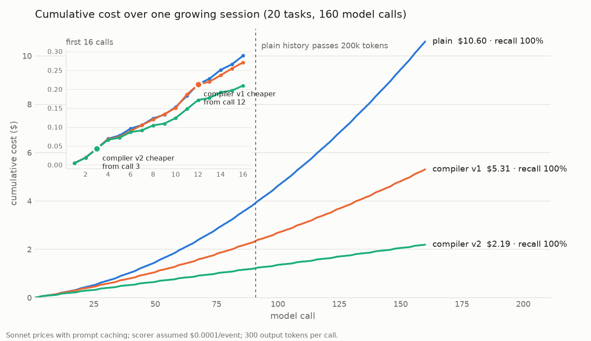

# Context compiler vs plain agent

This demo compares a **plain agent**, which sends its full history on every call, with
two **context-compiler agents**, which compile each call's context from an event log.
It measures cost, recall and prompt-cache hits over a coding session that keeps
growing. The KV cache is what decides which approach is cheaper: a compiler only wins
by a wide margin if it keeps the cached prefix intact.



## What a context compiler is

### One sentence
**A context compiler builds a fresh, purpose-made prompt for each model call from a
complete record of everything that has happened, instead of just sending the whole
conversation history.**

### Analogies
- **A briefing, not the whole archive.** A plain agent hands the model the entire filing
  cabinet every time. A context compiler keeps the cabinet (the event log) and writes a
  one-page brief for the question at hand: key facts in full, background as summaries,
  irrelevant items left out.
- **Source code and compiled output** (closest to the name). The event log is the source
  code: complete and never edited. The prompt is the compiled output, optimised for one
  purpose. Recompile whenever the question changes. The source is never lost.
- **A database and a query.** The log is the table. Each prompt is the result of a query
  against it for "what does this step need?"

### How it works (for engineers)
1. **Record:** every user message, tool call, tool result and model reasoning step is
   added to an event log, with a short and a long summary written once.
2. **Score:** before each call, a cheap scorer (rules, Jev or Haiku) rates each event for
   the current query: `hide`, `short`, `long` or `full`.
3. **Assemble:** a fixed system prompt, then the events at their chosen level.
4. **Respect the cache:** keep older blocks unchanged so the model's KV cache keeps
   working, and only add at the end.

### Why it matters
- **Cost:** a plain agent re-reads its whole history on every call, so cost grows with
  the square of session length. In this demo, the compiler costs **21% of the plain
  agent** over 160 calls ($2.19 versus $10.60).
- **No context ceiling:** plain history passed 200k tokens at about call 90. The
  compiler's prompts stayed around 7k tokens.
- **No lost information:** compaction throws detail away for good. A compiler can always
  go back to the log.
- **Other features come cheaply:** sub-agents, model routing and background tasks each
  just need their own compile.

### The honest catch
It only pays off if **scoring costs less than it saves** and if it **doesn't break the
KV cache**. This demo shows both sides: v1 re-scored everything every call and saved
almost nothing early on. v2 froze each event's level and saved 79% in the long session.

### Version for a slide
> **Context compiler:** instead of sending the model an ever-growing chat log, the agent
> keeps a complete event log and, for every call, compiles a short context tailored to
> the current step: important events in full, background as summaries, irrelevant ones
> hidden. Done in a cache-friendly way, it cuts cost by about 5× on long sessions without
> losing information.

## The three agents

All three read the same append-only event log. Each event stores its full text plus a
short and a long summary, written once when the event is added.

| Agent | What it sends on each model call |
|---|---|
| **plain** | Every event in full: the usual chat history. |
| **compiler v1** | Every event is re-scored against the current query and sent as `hide`, `short`, `long` or `full`. |
| **compiler v2** | Each new event is sent in full once. On the next call it is scored once and frozen at that level. |

The scorer is a word-overlap rule that stands in for Jev or Haiku. User messages
are always shown in full. v1 also always shows the last two events in full.

## Why the KV cache decides the result

Anthropic's prompt cache is the model's KV cache, kept by the provider. When a prompt
starts with exactly the same tokens as an earlier one, that prefix is billed at
$0.30 per million tokens. Anything after the first change is billed at the cache-write
price of $3.75 per million. A token's keys and values depend on every token before it,
so changing one early block invalidates everything after it.

- **plain** only ever adds to the end of its history, so about 99% of its input is
  cached. But it re-reads the whole history on every call, so cost grows with the
  square of session length.
- **compiler v1** sends far fewer tokens, but re-scoring keeps changing early
  blocks. That breaks the cached prefix almost every call (1% hit rate).
- **compiler v2** never changes a block once it is frozen. The context only grows
  at the end and stays small (about 2.5–7k tokens per call), so the cache keeps
  working and cost grows almost in a straight line.

## Results

The session repeats one scripted 10-event debugging task, with 8 model calls per task,
each on its own module:

| Tasks (calls) | plain | compiler v1 | compiler v2 | v2 as % of plain |
|---|---|---|---|---|
| 1 (8) | $0.12 | $0.12 | $0.10 | 85% |
| 5 (40) | $1.04 | $0.81 | $0.53 | 51% |
| 20 (160) | $10.60 | $5.31 | $2.19 | 21% |

- v2 is cheaper than plain from **call 3** onward. v1 only gets ahead at **call 12**.
- plain's history passes **200k tokens** (Sonnet's standard context limit) at about
  call 90. A real plain agent would have to compact or restart there.
- All three agents keep 100% recall: every fact a call needs is still in its context.

## Run it

```bash
python context_compiler/demo.py                                        # one task, per-call tables
python context_compiler/demo.py --episodes 20 --plot context_compiler/cost.png  # longer session, redraw the chart
```

No API key is needed. The chart needs `matplotlib`.

## Caveats

- **Pricing is Sonnet's,** with caching on every call and 300 output tokens per call.
  The demo ignores the cache's 5-minute expiry and its 1,024-token minimum.
- **The scorer's cost is assumed** at $0.0001 per event scored. Jev doesn't expose its
  price, so set `SCORER_COST_PER_EVENT` from your TypeSafe pricing.
- **Recall is a stand-in for success.** It checks whether the needed facts are in the
  context, not whether a model actually solves the task. The scripted tasks also
  repeat, which makes them easy for a word-overlap scorer.
- **v2's trade-off:** once an event is frozen at `short` or `hide`, a later query can't
  get its detail back. A real agent would re-add needed detail at the end of the
  context, so the cached prefix stays intact.
