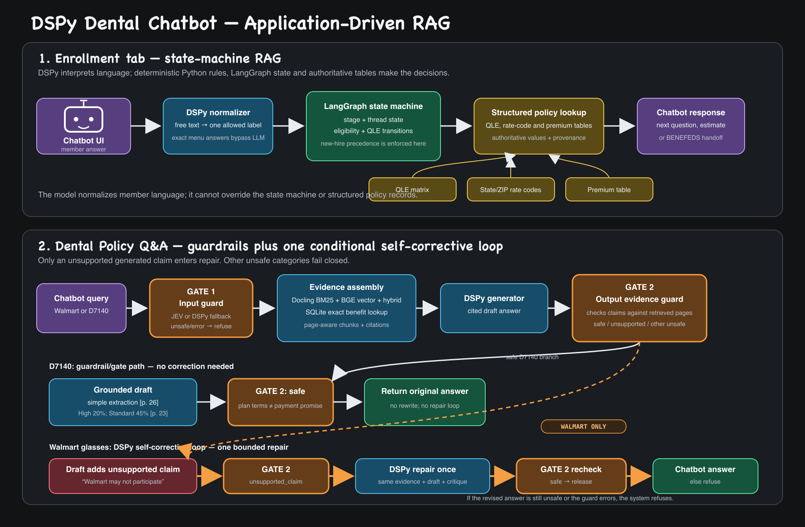

# DSPy Dental Chatbot

A Streamlit demonstration of two evidence-grounded dental-benefit assistants:

- a guided enrollment assistant whose policy decisions remain in a deterministic LangGraph workflow; and
- a policy Q&A assistant that combines local retrieval, structured benefit data, DSPy generation, citations, and safety checks.

The application also includes a retrieval-comparison workspace for inspecting how direct-PDF BM25 and the shared Docling corpus retrievers rank evidence.

> **Demo scope:** this project is not a production enrollment system, a coverage determination, medical advice, or a HIPAA-ready application. Always verify benefit details against the cited plan document.



## What the app provides

The Streamlit UI has three tabs.

| Tab | Purpose | Main components |
|---|---|---|
| **Enrollment chat** | Collect member status, enrollment opportunity, location, coverage tier, and dental need before presenting an estimate | DSPy semantic extraction + deterministic LangGraph policy workflow |
| **Dental Policy Q&A** | Answer questions from GEHA dental plan documents with inline page citations | Local retrieval + SQLite structured facts + DSPy answer generation + input/output guards |
| **Retrieval comparison** | Compare retrieved pages and scores across indexing strategies | Direct PDF BM25 vs. Docling BM25, BGE vector, and hybrid retrieval |

DSPy interprets free-form language, but it does not own eligibility, qualifying-life-event, pricing, or plan-selection rules. Those decisions remain in `src/enrollment_graph.py`.

## Policy Q&A flow

```text
member question
      |
      +--------------------> input safety guard
      |
      +--> query routing and expansion
              |
              +--> unstructured retrieval (BM25, vector, or hybrid)
              |
              +--> deterministic SQLite lookup for supported benefits
                         |
                         v
                 DSPy answer draft
                         |
                 citation validation
                         |
                  output safety guard
                    |            |
                  safe     unsupported claim
                    |            |
                  return    one bounded repair
                                   |
                              verify again
                                   |
                           return or refuse
```

Only retrieved text and structured records are supplied to the answer model. Answers use inline citations such as `[p. 7]`. A citation to a page that was not retrieved is rejected rather than silently presented.

### Retrieval modes

| UI option | Behavior |
|---|---|
| **Docling auto** | Uses BM25 for exact CDT-code questions and local BGE vector search for ordinary natural-language questions |
| **Docling hybrid** | Combines BM25 and vector rankings using reciprocal-rank fusion |
| **Docling vector** | Searches locally generated BGE embeddings |
| **Docling BM25** | Searches Docling page Markdown lexically |
| **Direct PDF BM25** | Uses the earlier `pypdf` page extraction and local BM25 index |

Exact `D####` questions search both the benefits guide and plan brochure and reserve exact-code BM25 evidence before broader retrieval. Other questions search the benefits guide by default. Every returned chunk retains document, plan-year, page, and section provenance.

The first vector query can take several seconds while `BAAI/bge-large-en-v1.5` loads. The model and initialized retriever are cached for later requests. Set `DENTAL_WARM_RETRIEVER=0` to disable background warm-up.

## Structured benefit facts

`data/dental_benefits.sqlite` holds authoritative rows for the supported structured examples. The runtime resolves procedure codes and service aliases deterministically, then supplies the selected record to the answer model as JSON with its source provenance.

This separation matters:

- BM25 and vector retrieval find relevant explanatory text;
- SQLite resolves supported costs, limits, and benefit rows; and
- the language model explains the evidence but does not align values across raw table columns.

Rebuild the database from the checked-in canonical extraction:

```bash
cd /Users/dc/geha/dspy_dental_chatbot
source ../.venv/bin/activate
PYTHONPATH=src python src/build_benefits_db.py
```

## Safety and grounding


`GuardedPolicyQA` in `src/safety_guard.py` applies two distinct checks:

1. The **input guard** classifies the request while retrieval and drafting run in parallel. It uses TypeSafe Jev when `TYPESAFE_API_KEY` is configured and DSPy otherwise.
2. The **output guard** uses DSPy to compare the draft with the retrieved evidence. It checks for unsupported claims, medical advice, coverage guarantees, personal-health-information disclosure, and instructions embedded in evidence.

Guard errors, timeouts, and unknown labels fail closed. An `unsupported_claim` verdict permits one repair using the same evidence, followed by one more verification. Other unsafe verdicts refuse immediately. The Streamlit answer exposes guard verdicts and retrieved evidence for inspection.

`DSPY_GUARD_MODEL` can point the DSPy guards at a less expensive model while the main answer program continues to use `DSPY_MODEL`.

## Source documents

The Docker image copies the canonical dental inputs from the repository:

- `crawl_dir/raw/dental/fedvip/2026-geha-dental-benefits-guide.pdf`
- the dental plan brochure and page-level corpus artifacts used by `agentic_search_corpus`

Do not replace the canonical source with UI-uploaded or generated text without regenerating the dependent retrieval caches and structured records.

## Quick start with Docker Compose

Run Compose from this directory. Its build context is the GEHA repository root because the image reuses `agentic_search_corpus`, `crawl_dir`, and the dental source artifacts.

```bash
cd /Users/dc/geha/dspy_dental_chatbot
cp .env.example .env  # first run only
# Edit .env and set DSPY_MODEL plus the matching provider credentials.

docker compose up --build
```

Open <http://localhost:8506>.

The initial build downloads the CPU BGE model and creates guide-only and guide-plus-brochure vector caches. Docker reuses those layers on later builds. Stop the service with:

```bash
docker compose down
```

To use a different host port while retaining container port `8506`:

```bash
DENTAL_PORT=8516 docker compose up
```

Then open <http://localhost:8516>.

## Local development

The project uses the repository virtual environment; it does not require Node or `package.json`.

```bash
cd /Users/dc/geha
source .venv/bin/activate
uv pip install --python .venv/bin/python \
  -r dspy_dental_chatbot/requirements.txt

cp dspy_dental_chatbot/.env.example dspy_dental_chatbot/.env  # first run only
# Edit dspy_dental_chatbot/.env.

./dspy_dental_chatbot/startup.sh
```

The app is available at <http://localhost:8506>.

## Configuration

| Variable | Required | Description |
|---|---:|---|
| `DSPY_MODEL` | Yes | LiteLLM-compatible model identifier, for example `openai/gpt-4o-mini` |
| `DSPY_API_KEY` | Usually | Provider key used by the configured DSPy endpoint |
| `DSPY_API_BASE` | No | Base URL for an OpenAI-compatible provider |
| `OPENAI_API_KEY` | Alternative | Used when `DSPY_API_KEY` is unset |
| `OPENROUTER_API_KEY` | Alternative | Used with an `openrouter/...` model identifier |
| `NOUS_KEY` | Alternative | Used for a configured Nous-compatible endpoint |
| `DSPY_PROGRAM_PATH` | No | Compiled router program created by `optimize_router.py` |
| `DSPY_GUARD_MODEL` | No | Separate model for DSPy input/output guards |
| `TYPESAFE_API_KEY` | No | Enables the TypeSafe Jev input guard and comparison tools |
| `DENTAL_WARM_RETRIEVER` | No | `1` warms BGE in the background; `0` defers loading |
| `DENTAL_TRACING` | No | Set to `1` to enable configured Langfuse tracing |
| `TRACE_TAGS` | No | Comma-separated trace tags |

Copy `.env.example`; do not commit `.env` or provider keys.

## Tests

The unit suite uses fake model programs and does not require live model calls:

```bash
cd /Users/dc/geha/dspy_dental_chatbot
source ../.venv/bin/activate
PYTHONPATH=src python -m unittest discover -s src -p 'test_*.py' -v
```

The tests cover the DSPy router, deterministic enrollment graph, QLE cases, retrievers, structured benefit lookup, policy answering, personas, citation behavior, and safety guards.

## Evaluations

### Policy retrieval

The default evaluator is local. It verifies that the expected page and required facts appear in the retrieved evidence:

```bash
cd /Users/dc/geha/dspy_dental_chatbot
source ../.venv/bin/activate
PYTHONPATH=src python src/evaluate_policy_qa.py
```

Add `--live` to generate answers with the configured DSPy model and check the required facts and citations:

```bash
PYTHONPATH=src python src/evaluate_policy_qa.py --live
```

Useful options are `--cases`, `--pdf`, `--top-k`, and `--output`. Without `--output`, reports are saved under `runs/policy-qa-eval-<timestamp>/results.json`.

### Enrollment personas

Run the scripted member simulator:

```bash
cd /Users/dc/geha/dspy_dental_chatbot
source ../.venv/bin/activate
PYTHONPATH=src python src/agent_member.py
PYTHONPATH=src python src/agent_member.py --persona widow --quiet
```

To exercise the visible Streamlit app, install Playwright's browser once, start the app, and run:

```bash
PYTHONPATH=src python src/agent_member_browser.py \
  --url http://localhost:8506 --headless
```

These are workflow evaluations, not autonomous production enrollment agents.

### DSPy and Jev comparisons

When `TYPESAFE_API_KEY` and the DSPy provider are configured, run both extractors on identical inputs:

```bash
PYTHONPATH=src python src/compare_jev_dspy.py
PYTHONPATH=src python src/compare_trajectories.py
```

Raw reports are written under timestamped `runs/jev-vs-dspy-*` and `runs/trajectory-jev-vs-dspy-*` directories. Checked-in results are historical artifacts; rerun the commands before reporting current accuracy, latency, token, or cost measurements.

## Optimize the enrollment router

`data/router_examples.json` contains labeled examples for the semantic enrollment router:

```bash
cd /Users/dc/geha/dspy_dental_chatbot
source ../.venv/bin/activate
PYTHONPATH=src python src/optimize_router.py \
  --data data/router_examples.json \
  --output compiled_router.json
```

Set `DSPY_PROGRAM_PATH=/absolute/path/to/compiled_router.json` before starting the application. Keep a held-out set separate from the examples used during compilation.

## Project map

| Path | Responsibility |
|---|---|
| `src/app.py` | Streamlit UI and tab orchestration |
| `src/enrollment_graph.py` | Deterministic enrollment and QLE workflow |
| `src/dspy_router.py` | DSPy semantic extractor and model configuration |
| `src/policy_qa.py` | Direct-PDF index, answer generation, and citation validation |
| `src/corpus_retriever.py` | Adapter for Docling BM25, BGE vector, hybrid, and auto retrieval |
| `src/structured_benefits.py` | Deterministic SQLite benefit lookup and provenance |
| `src/safety_guard.py` | Input/output guarding and bounded repair |
| `src/policy_personas.py` | Policy-Q&A persona scenarios and answer checks |
| `src/evaluate_policy_qa.py` | Local retrieval and optional live answer evaluation |
| `src/optimize_router.py` | DSPy router compilation |
| `data/` | SQLite benefits, persona definitions, evaluation cases, and router examples |
| `runs/` | Timestamped evaluation and comparison reports |

## Known boundaries

- The SQLite store contains a small, explicitly supported set of benefit rows; it is not a complete adjudication database.
- Local retrieval quality depends on the checked-in source documents and generated corpus artifacts.
- A page citation establishes where the answer found its evidence, not whether a future claim will be paid.
- The app does not authenticate members, access claims, submit enrollment, or modify coverage.
- Live evaluations consume provider requests and may incur cost.
